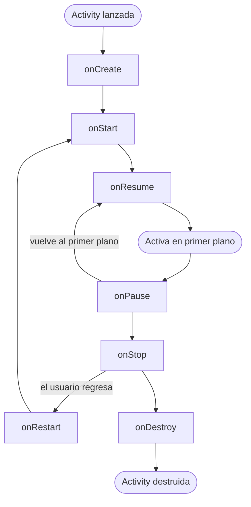
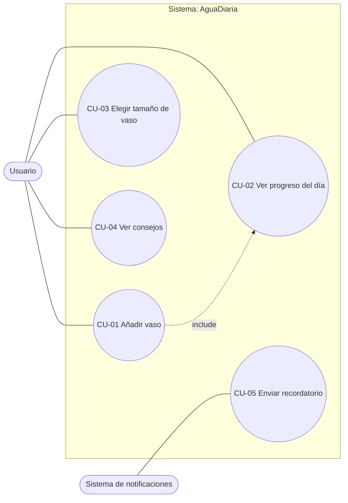

# AguaDiaria

App Android nativa (Java + vistas XML) para llevar la cuenta de los vasos de agua que se beben cada día.
Proyecto de la **Práctica 1 de PMDM**: de la idea al proyecto con recursos (textos, imágenes, colores, estilos e icono).

## Índice

1. [Datos del proyecto](#1-datos-del-proyecto)
2. [Parte A. Análisis del desarrollo móvil](#2-parte-a-análisis-del-desarrollo-móvil)
3. [Parte B. Especificación de la app](#3-parte-b-especificación-de-la-app)
4. [Parte C. Entorno de desarrollo y ejecución](#4-parte-c-entorno-de-desarrollo-y-ejecución)
5. [Parte D. Recursos de la aplicación](#5-parte-d-recursos-de-la-aplicación)
6. [Cómo ejecutar el proyecto](#6-cómo-ejecutar-el-proyecto)
7. [Historial de commits](#7-historial-de-commits)
8. [Conclusión personal](#8-conclusión-personal)

---

## 1. Datos del proyecto

| Campo | Valor |
|---|---|
| **Autor** | Pedro Eduardo De La Puente Rodríguez |
| **Proyecto** | PMDM_P1_PedroEduardoDeLaPuenteRodriguez |
| **Paquete** | `es.medac.pedroeduardodelapuenterodriguez.aguadiaria` |
| **Lenguaje** | Java con vistas XML |
| **Plantilla** | Empty Views Activity |
| **API mínima** | 24 (Android 7.0) |
| **Versión de Android Studio** | ESCRIBE AQUÍ TU VERSIÓN (Help → About) |

### Vista general de la app


---

## 2. Parte A. Análisis del desarrollo móvil

### 2.1 Ventajas e inconvenientes frente al escritorio o la web

**Ventajas:** el móvil acompaña siempre al usuario, de modo que una app de hidratación puede avisarle en el momento oportuno mediante notificaciones. Además ofrece sensores (GPS, cámara, acelerómetro), permite trabajar sin conexión y se distribuye desde tiendas oficiales.

**Inconvenientes:** hay una gran variedad de dispositivos, el hardware es más limitado, las tiendas exigen una revisión y hay que mantener la compatibilidad con varias versiones de Android.

### 2.2 Limitaciones y cómo afectan a AguaDiaria

| Limitación | Efecto en mi app |
|---|---|
| **Batería** | Los recordatorios no pueden mantener un servicio permanente activo. Se usarán tareas programadas del sistema (`WorkManager`) para gastar poca energía. |
| **Memoria** | Las imágenes grandes consumen RAM. Uso imágenes pequeñas y comprimidas y gráficos vectoriales. |
| **Conectividad** | La app debe funcionar sin internet, porque el usuario puede estar sin datos. El registro se guarda en el propio móvil. |
| **Tamaño de pantalla** | Debe verse bien en móviles pequeños y en tablets. Uso `ScrollView`, medidas en dp y textos en sp. |
| **Fragmentación** | Existen muchas versiones de Android y fabricantes. Fijo la API mínima 24 y pruebo en dos dispositivos virtuales distintos. |

### 2.3 Elección tecnológica

| Criterio | Nativo | Híbrido | Multiplataforma |
|---|---|---|---|
| **Lenguajes** | Java / Kotlin (Android) | HTML, CSS, JavaScript | Dart, JavaScript/TypeScript, C# |
| **Rendimiento** | Máximo | Más bajo (se ejecuta en un WebView) | Alto, cercano al nativo |
| **Acceso al hardware** | Completo y directo | Limitado, mediante plugins | Mediante plugins o puentes |
| **Coste** | Mayor si se necesita una app por sistema | Bajo (un único código web) | Medio-bajo (un código para varios sistemas) |
| **Ejemplo de framework** | Android SDK | Ionic / Apache Cordova | Flutter / React Native |

**Por qué nativo Android:** mi app depende de notificaciones y alarmas, que en nativo funcionan con mayor fiabilidad y menos consumo de batería. Además, el objetivo de la asignatura es aprender Android con Java y vistas XML, y el desarrollo nativo da acceso completo al sistema de recursos (strings, colores, estilos, mipmap) que es el eje de esta práctica.

### 2.4 Ciclo de vida de la Activity



| Escenario | Métodos que se ejecutan | Qué ocurre en AguaDiaria |
|---|---|---|
| **Llamada entrante** | `onPause()` y, si la pantalla de llamada ocupa todo, `onStop()`. Al volver: `onRestart()` → `onStart()` → `onResume()` | La app queda en segundo plano. El contador de vasos se conserva y al volver el usuario sigue donde estaba. |
| **Girar el móvil** | `onPause()` → `onStop()` → `onDestroy()` → `onCreate()` → `onStart()` → `onResume()` | Android destruye y recrea la Activity. Con `onSaveInstanceState()` se conservan los vasos para que no se pierdan. |
| **Botón Atrás** | `onPause()` → `onStop()` → `onDestroy()` | La Activity se cierra. Lo guardado en almacenamiento persiste y lo que no se guardó se pierde. |

---

## 3. Parte B. Especificación de la app

### 3.1 Idea y público objetivo

AguaDiaria es una app para llevar la cuenta de los vasos de agua que bebe una persona cada día. El usuario indica el tamaño de su vaso, pulsa "Añadir vaso" cada vez que bebe y ve cuánto le falta para su meta diaria. Resuelve un problema habitual: mucha gente olvida hidratarse, sobre todo mientras estudia o trabaja sentada. Está dirigida a estudiantes y trabajadores de 16 a 45 años, sin conocimientos técnicos, que quieren crear un hábito saludable con una herramienta muy simple y rápida de usar.

### 3.2 Objetivos medibles

1. Que el usuario registre un vaso en **máximo 2 toques y menos de 5 segundos**.
2. Que la pantalla principal muestre el progreso diario (vasos bebidos / meta) **siempre actualizado, sin retraso apreciable**.
3. Que un usuario nuevo comprenda la app y registre su primer vaso **en menos de 1 minuto sin ayuda**.

### 3.3 Requisitos funcionales

| ID | Requisito | Prioridad |
|---|---|---|
| RF-01 | El usuario puede añadir un vaso de agua al contador del día. | Alta |
| RF-02 | La app muestra el progreso del día (vasos bebidos de la meta). | Alta |
| RF-03 | El usuario puede elegir el tamaño del vaso (pequeño, mediano, grande). | Alta |
| RF-04 | El usuario puede consultar consejos de hidratación. | Media |
| RF-05 | La app guarda el registro diario en el dispositivo. | Media |
| RF-06 | La app envía un recordatorio para beber agua. | Media |
| RF-07 | La app se muestra en español o inglés según el idioma del sistema. | Baja |

### 3.4 Requisitos no funcionales

| ID | Tipo | Requisito verificable |
|---|---|---|
| RNF-01 | Rendimiento | La pantalla principal carga en menos de 2 segundos en un dispositivo con 3 GB de RAM. |
| RNF-02 | Compatibilidad | API mínima 24 (Android 7.0), porque cubre más del 95 % de los dispositivos activos y permite usar componentes modernos. Se comprueba en el asistente de creación del proyecto. |
| RNF-03 | Usabilidad | Un usuario nuevo registra su primer vaso en menos de 1 minuto sin ayuda. |
| RNF-04 | Usabilidad | Los textos tienen un tamaño mínimo de 16 sp y los botones una altura mínima de 48 dp. |
| RNF-05 | Rendimiento | La app instalada ocupa menos de 15 MB. |

### 3.5 Casos de uso

**Actores:** Usuario (principal) y Sistema de notificaciones (secundario).



INSERTAR AQUÍ LA CAPTURA DEL DIAGRAMA DE CASOS DE USO REDIBUJADO EN DRAW.IO (ARCHIVO `capturas/casos_de_uso.png`)


La relación `include` entre CU-01 y CU-02 indica que, cada vez que el usuario añade un vaso, el sistema actualiza obligatoriamente el progreso del día.

#### Ficha CU-01: Añadir vaso

| Campo | Contenido |
|---|---|
| **Actor** | Usuario |
| **Precondición** | La app está abierta en la pantalla principal. |
| **Flujo principal** | 1) El usuario elige el tamaño del vaso. 2) Pulsa "Añadir vaso". 3) La app suma el vaso al contador. 4) La app actualiza el texto de progreso. |
| **Flujo alternativo** | 3a) Si ya alcanzó la meta, la app muestra un aviso de meta cumplida y deja añadir más. |
| **Postcondición** | El contador del día aumenta en uno y el progreso queda actualizado. |

#### Ficha CU-04: Ver consejos

| Campo | Contenido |
|---|---|
| **Actor** | Usuario |
| **Precondición** | La app está abierta en la pantalla principal. |
| **Flujo principal** | 1) El usuario pulsa "Ver consejos". 2) La app abre la pantalla de consejos. 3) El usuario lee los consejos. 4) Pulsa Atrás para volver. |
| **Flujo alternativo** | 2a) Si no se pueden cargar los consejos, la app muestra un mensaje de error y permite volver. |
| **Postcondición** | El usuario vuelve a la pantalla principal con su progreso intacto. |

---

## 4. Parte C. Entorno de desarrollo y ejecución

### 4.1 Creación del proyecto

- **Nombre:** `PMDM_P1_PedroEduardoDeLaPuenteRodriguez`
- **Paquete:** `es.medac.pedroeduardodelapuenterodriguez.aguadiaria`
- **Plantilla:** Empty Views Activity
- **Lenguaje:** Java
- **API mínima:** 24


### 4.2 Dispositivos virtuales (AVD)

| AVD | Tipo | Resolución | Densidad | API |
|---|---|---|---|---|
| Pixel 6 | Móvil | 1080 × 2400 px | 420 dpi | 37.2 |
| Pixel Tablet | Tablet | 2560 × 1600 px | 276 dpi |


### 4.3 Ejecución en ambos dispositivos

| Móvil (Pixel 6) | Tablet (Pixel Tablet) |
|---|---|


### 4.4 Estructura del proyecto


- **`AndroidManifest.xml`:** es la ficha de la app. Declara el nombre, el icono (`android:icon`), el tema (`android:theme`) y qué Activity se abre primero (la que tiene el `intent-filter` MAIN/LAUNCHER).
- **`java/`:** contiene el código Java. Aquí está `MainActivity.java`, que controla el comportamiento de la pantalla.
- **`res/`:** guarda los recursos sin código: `layout/` (diseños XML), `values/` (textos, colores, medidas, estilos), `drawable/` (imágenes) y `mipmap-*/` (icono del lanzador).
- **Ficheros Gradle** (`build.gradle`, `settings.gradle`): definen cómo se compila la app: versión mínima (`minSdk 24`), versión objetivo, el paquete y las dependencias.
- **Relación Activity-layout:** `MainActivity.java` es la lógica y `activity_main.xml` es el diseño. Se unen con `setContentView(R.layout.activity_main)`. La clase `R`, generada automáticamente, permite acceder a los recursos desde Java, por ejemplo con `findViewById(R.id.tv_saludo)`.

---

## 5. Parte D. Recursos de la aplicación

Regla aplicada en todo el proyecto: **ningún texto, color ni medida está escrito a mano en los layouts**. Todo se define en `res/values` y se referencia con `@string/`, `@color/`, `@dimen/` y `@style/`.

### 5.1 Pantalla diseñada

La app tiene una pantalla principal (`activity_main.xml`) con título, saludo con parámetro, imagen vectorial, imagen de mapa de bits, texto de progreso, selector de tamaño de vaso y dos botones.


### 5.2 Textos (`res/values/strings.xml`)

Hay **10 strings**, **1 `string-array`** y **2 textos con parámetros** (`%1$s` y `%1$d` / `%2$d`).

| Nombre del recurso | Texto en español |
|---|---|
| `app_name` | AguaDiaria |
| `titulo_principal` | Mi agua de hoy |
| `saludo` | Hola, %1$s. ¡A beber agua! |
| `progreso` | Llevas %1$d de %2$d vasos |
| `etiqueta_tamano` | Tamaño del vaso |
| `boton_anadir` | Añadir vaso |
| `boton_consejos` | Ver consejos |
| `desc_gota` | Icono de una gota de agua |
| `desc_vaso` | Fotografía de un vaso de agua |
| `nombre_ejemplo` | Pedro |
| `tamanos_vaso` (string-array) | Pequeño (150 ml), Mediano (250 ml), Grande (350 ml) |

Uso en el layout: `android:text="@string/boton_anadir"`. Uso del parámetro en Java: `getString(R.string.saludo, getString(R.string.nombre_ejemplo))`.


### 5.3 Internacionalización (`res/values-en/strings.xml`)

La app está traducida al inglés con **todos** los textos y el `string-array`. Android elige el idioma automáticamente según el idioma del sistema del dispositivo.

| Español (`values`) | Inglés (`values-en`) |
|---|---|
| Mi agua de hoy | My water today |
| Hola, %1$s. ¡A beber agua! | Hi, %1$s. Time to drink water! |
| Llevas %1$d de %2$d vasos | You have had %1$d of %2$d glasses |
| Tamaño del vaso | Glass size |
| Añadir vaso | Add glass |
| Ver consejos | See tips |

| App en español | App en inglés |
|---|---|


### 5.4 Imágenes

| Imagen | Tipo | Ubicación | Uso |
|---|---|---|---|
| `ic_gota` | Vectorial (Vector Asset, XML) | `res/drawable` | Icono de gota de agua |
| `img_vaso` | Mapa de bits (PNG/JPG) | `res/drawable` | Fotografía de un vaso de agua |


**Cuándo conviene cada formato:** el Vector Asset es un archivo XML de pocos KB que se escala a cualquier tamaño y densidad de pantalla sin perder nitidez, por lo que es ideal para iconos y formas simples (la gota). Una fotografía, en cambio, no puede describirse con formas geométricas simples, así que necesita un mapa de bits. Este ocupa más y obliga a tener versiones por densidad, por lo que lo limito a la imagen imprescindible y lo comprimo para que la app pese menos.

### 5.5 Colores (`res/values/colors.xml`)

| Nombre (por función) | Valor | Uso |
|---|---|---|
| `color_primario` | `#0277BD` | Botones y elementos principales |
| `color_primario_oscuro` | `#01579B` | Barra de estado |
| `color_secundario` | `#4FC3F7` | Elementos secundarios |
| `color_fondo` | `#F1F8FE` | Fondo de la pantalla |
| `color_texto_principal` | `#12283A` | Texto general |
| `color_texto_sobre_primario` | `#FFFFFF` | Texto sobre botones |
| `color_acento` | `#FFB74D` | Elementos destacados |

**Justificación de la paleta:** uso tonos azules porque la temática es el agua: transmiten frescura y salud. El fondo es un azul casi blanco que da sensación de limpieza y deja buen contraste con el texto azul oscuro, lo que mejora la legibilidad. El naranja del color de acento sirve para destacar un elemento puntual y contrasta con el azul. Los nombres indican la función del color y no su aspecto, para poder cambiar la paleta sin renombrar nada.


### 5.6 Estilos y tema (`res/values/themes.xml`)

- **Tema propio:** `Theme.AguaDiaria`, que usa mis colores (`colorPrimary`, `colorSecondary`, fondo de ventana y barra de estado). Se aplica en el Manifest con `android:theme="@style/Theme.AguaDiaria"`.
- **Estilos propios reutilizados:**

| Estilo | Qué define | Dónde se reutiliza |
|---|---|---|
| `EstiloTitulo` | Tamaño, color, negrita y margen del título | Título de la pantalla |
| `EstiloTextoNormal` | Tamaño, color y margen del texto | Saludo, progreso y etiqueta del selector (3 veces) |
| `EstiloBotonPrincipal` | Altura mínima, color de fondo y texto | Botón "Añadir vaso" y botón "Ver consejos" (2 veces) |

**Unidades:** las medidas están en `dp` (en `dimens.xml`: márgenes, altura de botón, tamaño de imagen) y los textos en `sp` (`tamano_titulo` = 26 sp, `tamano_texto` = 16 sp). No se usa ningún `px`.


### 5.7 Icono de la aplicación

Icono adaptativo propio creado con **Image Asset** (Launcher Icons, Adaptive and Legacy): una gota de agua como capa frontal sobre un fondo de color azul `#0277BD`. Se generó en las carpetas `res/mipmap-*` y se aplica en el Manifest:

```xml
android:icon="@mipmap/ic_launcher"
android:roundIcon="@mipmap/ic_launcher_round"
```


---

## 6. Cómo ejecutar el proyecto

1. Clonar el repositorio:
   ```bash
   git clone PEGA_AQUÍ_LA_URL_DE_TU_REPOSITORIO
   ```
2. Abrir la carpeta con **Android Studio**.
3. Esperar a que termine la sincronización de Gradle.
4. Elegir un dispositivo virtual (API 24 o superior) en el desplegable de la barra superior.
5. Pulsar el triángulo verde (**Run**).

---

## 7. Historial de commits

El proyecto se ha desarrollado por bloques, con un commit descriptivo por cada uno.

CAPTURA: PESTAÑA COMMITS DE GITHUB MOSTRANDO 6 O MÁS COMMITS REPARTIDOS EN VARIOS DÍAS (ARCHIVO `capturas/commits.png`)


| Bloque | Mensaje de commit |
|---|---|
| Proyecto base | `Crea proyecto base con paquete es.medac...` |
| Textos | `Añade strings.xml con textos, parámetros y string-array` |
| Traducción | `Añade traducción al inglés en values-en` |
| Colores y medidas | `Define paleta de colores y dimens` |
| Estilos y tema | `Crea estilos propios y tema personalizado` |
| Imágenes | `Añade imagen vectorial y bitmap` |
| Pantalla | `Diseña pantalla principal con recursos` |
| Icono | `Añade icono adaptativo` |
| Documentación | `Añade capturas y README` |

El repositorio excluye la carpeta `build/` mediante `.gitignore`.

---

## 8. Conclusión personal

## 8. Conclusión personal

Con esta práctica he aprendido que crear una app Android no consiste solo en programar funciones, sino en preparar bien el proyecto desde el principio.
El análisis de la Parte A y la especificación de la Parte B me obligaron a pensar para quién era la app, qué limitaciones tiene un móvil (batería, memoria, conectividad, tamaño de pantalla y fragmentación) y por qué el desarrollo nativo en Java encajaba con una app de recordatorios.
Además, redactar requisitos funcionales y no funcionales medibles me ayudó a distinguir lo que hace la app de lo bien que lo hace.
Lo más valioso ha sido entender la gestión de recursos: guardar textos, colores, medidas y estilos en `res/values` en lugar de escribirlos en los layouts permite cambiar el idioma o el aspecto sin tocar los diseños.
Lo comprobé con la traducción al inglés, ya que Android eligió el idioma por sí solo según la configuración del emulador.
También entendí por qué conviene usar una imagen vectorial para la gota y un mapa de bits solo para la fotografía, y por qué las medidas van en dp y los textos en sp.
Lo que más me costó fueron los errores de configuración: primero un `cannot find symbol` en `MainActivity.java`, porque al sustituir el layout desapareció el identificador `main` que esperaba la plantilla, y después un error de vinculación de recursos en el `AndroidManifest.xml`, que seguía apuntando al nombre del tema anterior tras personalizar `themes.xml`.
Resolverlos me enseñó a leer los mensajes de la pestaña Build y a entender cómo se relacionan el Manifest, los recursos y la Activity.
También tuve que aprender a manejar el emulador para cambiar su idioma y ajustar el zoom al hacer las capturas.
Trabajar con dos dispositivos virtuales de distinto tamaño y densidad me hizo ver que la fragmentación es un problema real del desarrollo móvil, y mantener un repositorio en GitHub con commits por bloques me ayudó a ordenar el trabajo.
Como mejoras futuras, me gustaría guardar el registro de vasos de forma permanente, crear la pantalla de consejos que hoy solo está planteada y programar los recordatorios reales con `WorkManager`, para lo que ya tengo una base sólida porque el proyecto está bien organizado y sus recursos están separados del código.

---

**Autor:** Pedro Eduardo De La Puente Rodríguez
